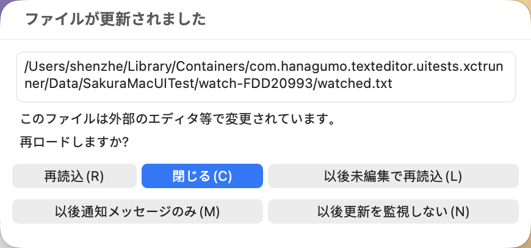
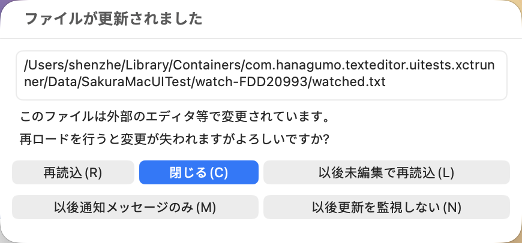
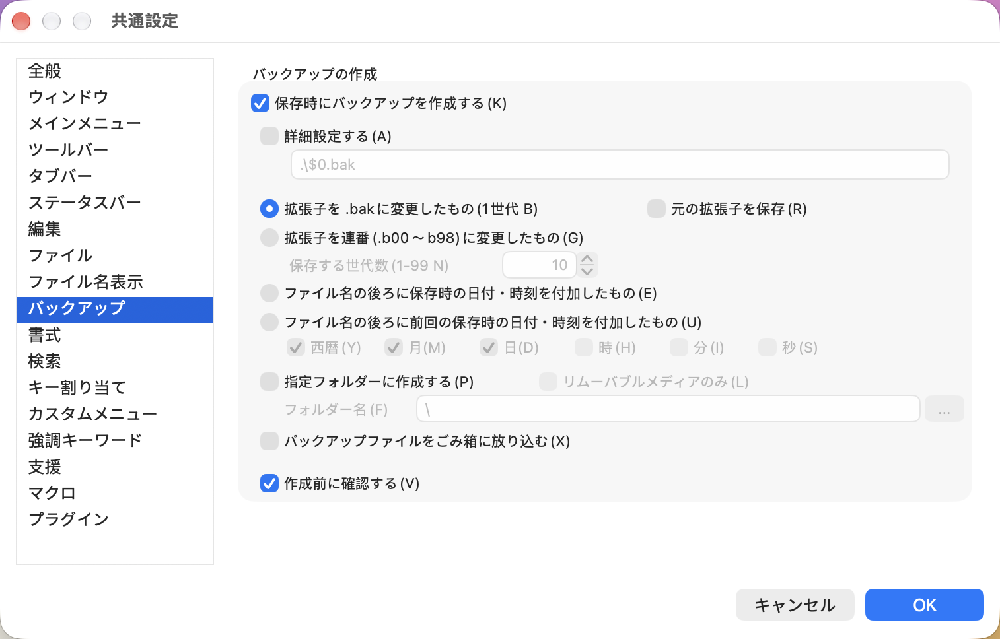
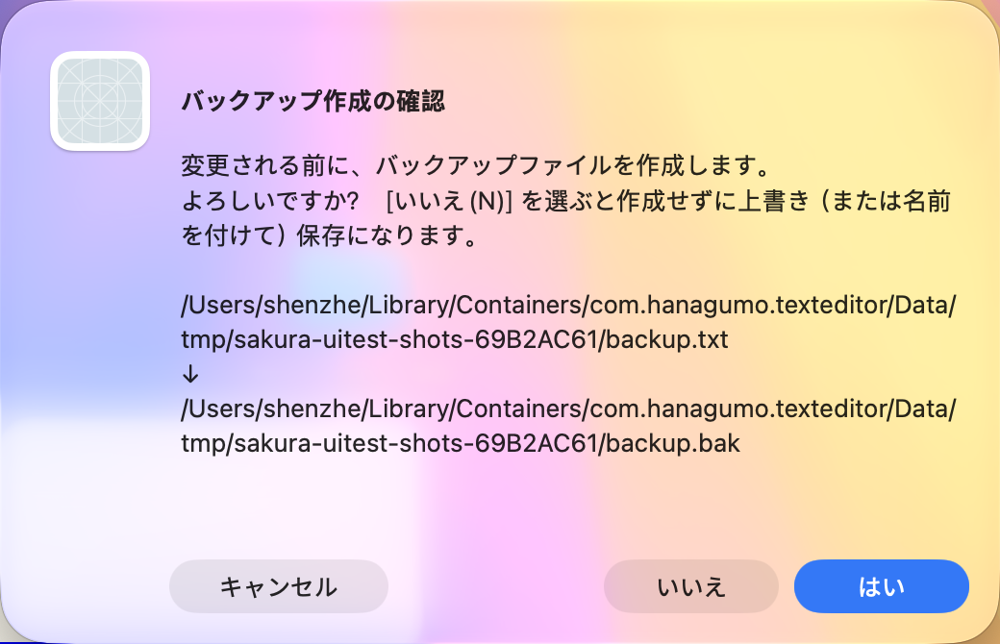
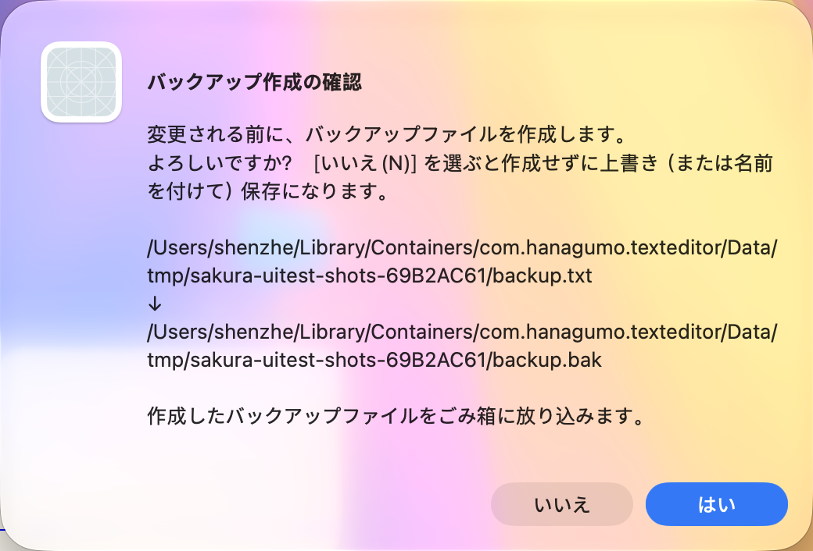

# 阶段 3：文件的安全功能（计划第 46 步）

原版保存时的备份（CBackupAgent）、自动保存（CAutoSaveAgent）、文件更新的监视（CAutoReloadAgent・CDlgFileUpdateQuery）做成 Mac 版。

1. **核心库（commit ff0b0ac）**：原版 `CBackupAgent::FormatBackUpPath`・`MakeBackUp`・`OnPreBeforeSave` 移到 `macos/core/api/Backup.cpp`；
   桥接层 `BackupCore`・`BackupHandler`。CI 的 `backup-windows` 用官方版 sakura.exe 做同样的备份，与 `data/backup/expected.txt` 比较。
2. **App**：`macos/app/Sources/FileSafety.swift`（确认的对话框、自动保存、更新的监视）、`FileUpdateQueryDialog.swift`（「ファイルが更新されました」）、
   `SakuraDocument.swift` 的保存流程。

## 保存时的备份（原版 CBackupAgent）

| 行为 | 原版 | Mac 版 |
|---|---|---|
| 时机 | `CDocFileOperation::DoSaveFlow`：保存前的检查（CCodeChecker）之后、保存前的自动执行宏之前（`NotifyPreBeforeSave`） | 相同：`SakuraDocument.save(to:…)` 里 `confirmSave` 之后、`nMacroOnSave` 之前 |
| 对象 | 保存的目标文件（`pSaveInfo->cFilePath`）存在时 | 相同。名前を付けて保存到别的已有文件时备份那个文件；新文件不做 |
| 文件名的书式 | .bak、元の拡張子を保存、連番 .b00～、日付・時刻、詳細設定（$0～$9、*、%Y 等） | 相同（核心库，与 Windows 官方版对照） |
| 指定フォルダー | 相对路径从当前文件夹算 | **从文件所在的文件夹算**（Mac 的 App 没有有意义的当前文件夹） |
| リムーバブルメディアのみ・ごみ箱 | `GetDriveType`：リムーバブル・CD・网络驱动器不是本地 | `IsLocalDrive`（`statfs` 的 `MNT_LOCAL`）：只有网络卷不是本地，外接磁盘也算本地 |
| 作成前に確認する | `MB_YESNOCANCEL \| MB_ICONQUESTION` | `NSAlert`（はい・いいえ・キャンセル，Esc 是キャンセル）。いいえ：不做继续保存；キャンセル：中止保存 |
| ごみ箱に放り込む | 复制后 `SHFileOperation` 删到回收站，确认是 はい・いいえ | 复制后 `FileManager.trashItem` |
| 失败时 | 「バックアップの作成に失敗しました．元ファイルへの上書きを継続して行いますか．」 | 相同（核心库问，App 显示） |
| 题目为空的确认（TopConfirmMessage） | 题目是 App 名 | 相同（`CommonSettingsPages.appName`） |
| 文件的锁 | 备份前后解除・恢复锁 | Mac 版不锁文件，没有这一步 |
| 沙盒 | 无 | 第一次在一个文件夹做备份时，用「開く」面板请用户允许那个文件夹（没有时是上一层：原版只建一层文件夹），记安全书签。不允许也继续（做不成，按上一行问是否继续） |

## 自动保存（原版 CAutoSaveAgent・CPassiveTimer）

| 行为 | 原版 | Mac 版 |
|---|---|---|
| 设置 | 共通設定『ファイル』「自動的に保存する」（`bBackUpType2_Opt1` 的 BKUP_AUTO 64）、「間隔は ○ 分ごと」（`bBackUpType2_Opt3`，1～35791） | 相同 |
| 计时 | `CPassiveTimer`：无效→有效时重新开始计时，编辑窗口的 500 ms 计时器每次调查 | 相同（`PassiveTimer`，每个文档一个 500 ms 的计时器） |
| 保存 | 时间到了、修改过、有文件名时 `FileSave()`（与「上書き保存」相同）；保存中停止计时器 | 相同（`save(withDelegate:…)`，与 ⌘S 相同的流程：保存前检查、备份）。保存结束后恢复 |
| 设置改了 | `ReloadAutoSaveParam` | 文档打开时、共通設定 OK 时（`commonSettingsDidChangeNotification`） |
| 模态对话框中 | 计时器的消息照常处理 | 表单（sheet）或模态对话框显示时不保存，关闭后保存 |

## 文件更新的监视（原版 CAutoReloadAgent・CDlgFileUpdateQuery）

| 行为 | 原版 | Mac 版 |
|---|---|---|
| 调查的间隔 | `CEditWnd::OnEditTimer`：500 ms 的 6 次一次（3 秒），鼠标没有拖动时 | 相同 |
| 条件（_ToDoChecking） | 「更新の監視」on、不是 WU_NONE、没有暂停、排他制御是「しない」、编辑窗口是活动窗口、有文件名、有时间戳 | 相同，只是**不看「排他制御」**（Mac 版不锁文件）。活动窗口：App 在前面且这个窗口是 key window |
| 比较 | 打开・保存时记下的 FILETIME 与文件的不同（变旧也算） | 相同（打开・开き直す・保存时记下 `Date`） |
| WU_QUERY | 对话框「ファイルが更新されました」（模态） | 相同的布局（`Resources/FileSafetyDialogs.json`，从 IDD_FILEUPDATEQUERY 生成），模态 |
| 对话框的回答 | 再読込→重新读入、WU_QUERY；閉じる/Esc→WU_QUERY；以後未編集で再読込→重新读入、WU_AUTOLOAD、延迟计数 0；以後通知メッセージのみ→WU_NOTIFY；以後更新を監視しない→WU_NONE | 相同 |
| WU_NOTIFY | 状态栏「★ファイル更新 hh:mm:ss」（文件的更新时刻） | 编辑区左下的状态消息（第 44 步的 StatusMessage），4 秒后消失 |
| WU_AUTOLOAD | 未编辑时不问直接重新读入；编辑过时问。`nAutoloadDelay` 次以后才调查 | 相同 |
| 保存中 | `OnBeforeSave` 暂停，`OnAfterSave` 恢复；名前を付けて保存后回到 WU_QUERY | 相同 |
| 读入时 | `CEditDoc::InitDoc` 回到 WU_QUERY（開き直す、閉じて(無題) 等） | 相同 |
| NSDocument 自己的检查 | — | NSDocument 保存时会出「ほかのアプリケーションで変更されました」：保存前把 NSDocument 记的日期换成文件现在的日期，不出（原版保存时不确认）。`presentedItemDidChange` 什么也不做（不自动重新读入） |

## 与原版不同的地方

- 指定フォルダー的相对路径从文件所在的文件夹算。
- 沙盒：备份的文件夹第一次要用户允许。
- リムーバブルメディアのみ 的判断用 `IsLocalDrive`（`statfs` 的 `MNT_LOCAL`）：外接磁盘也算本地，只有网络卷算「リムーバブル」。
- 不锁文件：「排他制御」不起作用，更新的监视也不看它。
- 「★ファイル更新」显示在编辑区左下（Mac 版还没有状态栏）。
- 「ファイルが更新されました」的文件名栏按字折行；两行放不下的长路径（沙盒容器里的深路径等）把栏加高，下面的控件和对话框跟着下移，文件名总能看到（原版的栏是固定的 25 对话框单位）。

## 测试

- 核心库 `test-mac-backup.cpp`（书式、作成、确认、ごみ箱、`BackupWindowsComparison` 与官方版的对照）。
- App `FileSafetyTests`（19 个）：保存时的备份（各种类、确认的 はい・いいえ・キャンセル、ごみ箱、失败、另存为）、
  外部修改后保存不出 NSDocument 的确认、自动保存（换掉时钟）、更新的监视的每个回答、延迟、暂停、条件、计时器的 6 次、对话框的文字和按钮。
- 界面测试 `testFileUpdateQueryReload`、`testFileUpdateAutoload`、`testBackupOnSave`。

## 截图

- 
  「ファイルが更新されました」对话框（文档未修改）：长路径按字折行完整显示，问「再ロードしますか?」。
- 
  同一对话框（文档已修改）：提示「再ロードを行うと変更が失われますがよろしいですか?」。
- 
  选「以後通知メッセージのみ」后，外部修改只在编辑区左下显示「★ファイル更新 10:21:16」，标题栏带「(更新)」。
- 
  共通設定的「バックアップ」页：保存时备份、各种备份方式、指定フォルダー、ごみ箱、作成前に確認する。
- 
  「バックアップ作成の確認」对话框：显示原文件 → 备份文件的路径，按钮 キャンセル・いいえ・はい。
- 
  同一确认对话框（开了「ごみ箱に放り込む」）：多一行「作成したバックアップファイルをごみ箱に放り込みます。」，按钮只有 いいえ・はい。
