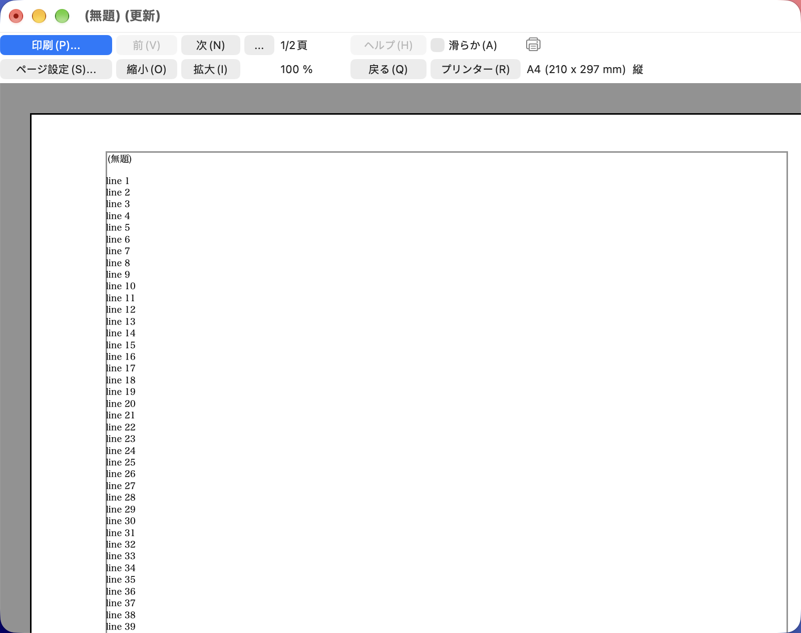
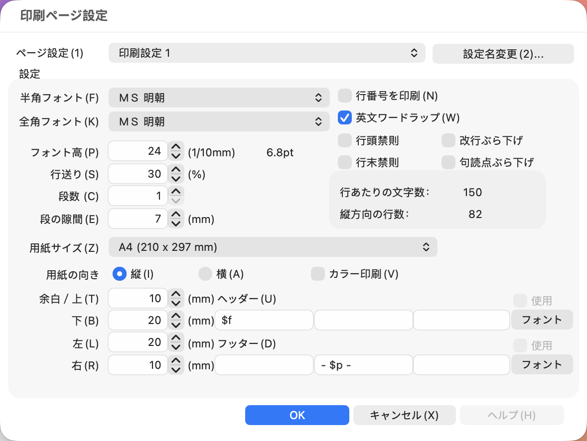
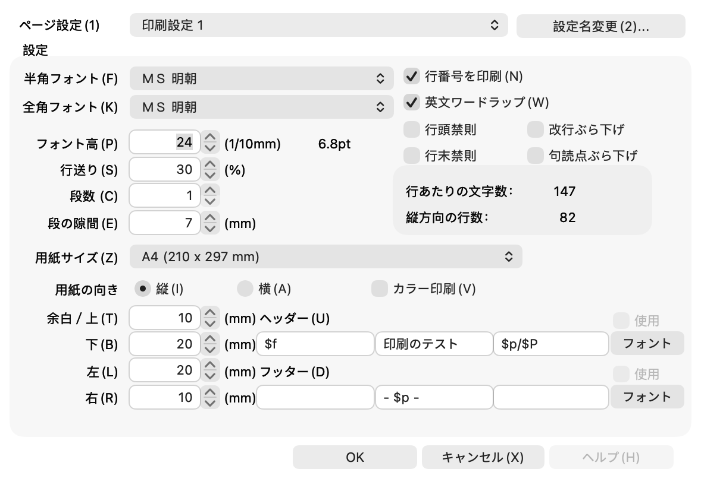
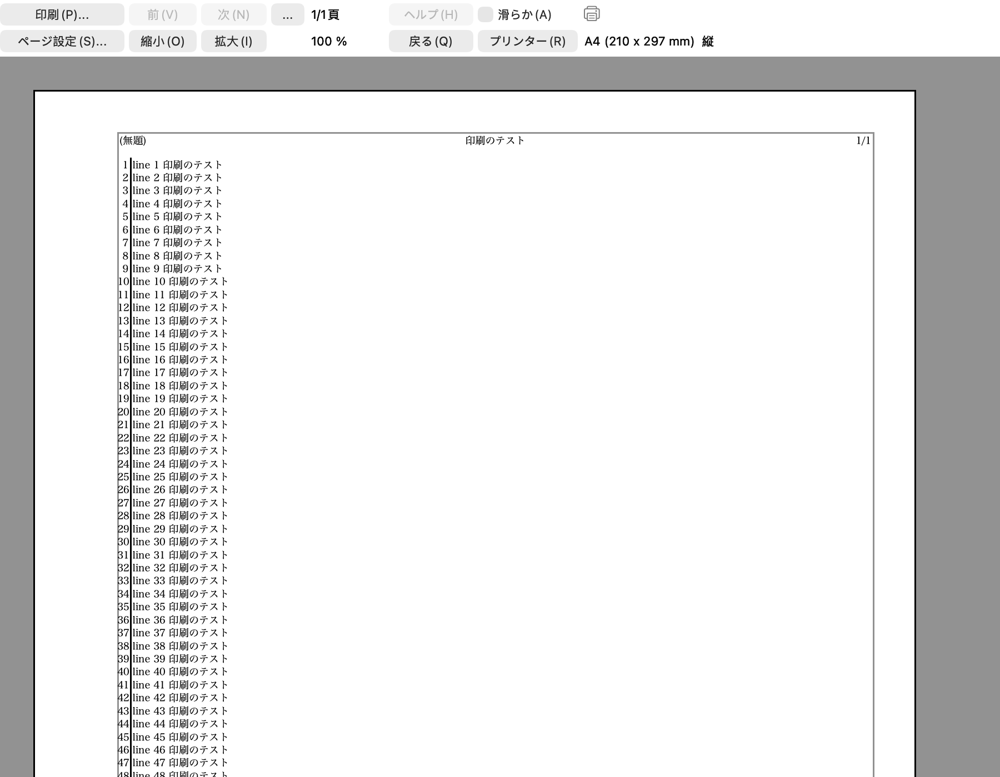

# 阶段 3：印刷与印刷プレビュー（计划第 47 步）

原版的印刷（CPrint・CPrintPreview）、印刷プレビュー、印刷ページ設定（CDlgPrintSetting）做成 Mac 版。

1. **核心库**：`macos/core/api/Print.cpp`。原版 `CPrint`（用紙の表、桁数・行数の計算、ヘッダー・フッターの高さ）、
   `CPrintPreview` の排版（印刷用の `CLayoutMgr`、`DrawPageText`・`Print_DrawLine`・`Print_DrawBlock`・`DrawHeaderFooter` の位置の計算）を移して、
   ページごとの「文字の並び（位置・送り幅・色・太字・下線）」「フォント指定のヘッダー・フッター」「行番号の区切り線」を返す。描画はしない。
   印刷ページ設定 8 つは原版と同じ sakura.ini の `[Print]`（`PS[00]`～`PS[07]`）に読み書きする。
2. **App**：`PrintPreview.swift`（描画・プレビュー・印刷）、`PrintSettingDialog.swift`（印刷ページ設定）、`SakuraDocument.swift`・`EditorWindowController.swift`（機能）。
   布局は原版の対話框の模板から（`Resources/PrintDialogs.json`：IDD_PRINTSETTING・IDD_PRINTPREVIEWBAR・IDD_PRINTING）。

## 印刷ページ設定の項目（完成标志：原版的设置项都有对应）

| 原版の項目（PRINTSETTING） | sakura.ini | Mac 版 |
|---|---|---|
| 設定名 `m_szPrintSettingName`（32 文字） | `PS[nn].szSName` | 相同。「設定名変更(2)...」（STR_DLGPRNST1・2） |
| 半角フォント `m_szPrintFontFaceHan` | `szFF` | 相同。Mac のフォントの一覧＋設定にある Windows のフォント名。印刷は Mac のフォントに代える（下の表） |
| 全角フォント `m_szPrintFontFaceZen` | `szFFZ` | 同上 |
| フォント高 `m_nPrintFontHeight`（1/10 mm、7～200） | `nInts[0]` | 相同。ポイント数の表示（`%d.%dpt`）も相同 |
| フォント幅 `m_nPrintFontWidth`（高さの半分） | `nInts[1]` | 相同（フォント高から計算） |
| 段数 `m_nPrintDansuu`（1～4） | `nInts[2]` | 相同 |
| 段の隙間 `m_nPrintDanSpace`（0～30 mm） | `nInts[3]` | 相同 |
| 行送り `m_nPrintLineSpacing`（0～150 %） | `nInts[4]` | 相同 |
| 余白 上・下・左・右（0～50 mm） | `nInts[5]`～`[8]` | 相同 |
| 用紙の向き `m_nPrintPaperOrientation` | `nInts[9]` | 相同（縦・横） |
| 用紙サイズ `m_nPrintPaperSize`（DMPAPER_*） | `nInts[10]` | 相同（原版の用紙の表 41 種、名前も相同） |
| カラー印刷 `m_bColorPrint` | `nInts[11]` | 相同：タイプ別設定の色・太字・下線で印刷 |
| 英文ワードラップ `m_bPrintWordWrap` | `nInts[12]` | 相同 |
| 行番号を印刷 `m_bPrintLineNumber` | `nInts[13]` | 相同（桁数は文書の行数から、区切りの縦線も） |
| 行頭禁則・行末禁則・改行ぶら下げ・句読点ぶら下げ | `nInts[14]`～`[17]` | 相同 |
| ヘッダー 左・中央・右（99 文字、`$f` `$p` `$P` 等） | `szHF[0]`～`[2]` | 相同（核心库の ExpandParameter） |
| フッター 左・中央・右 | `szFTF[0]`～`[2]` | 相同 |
| ヘッダー・フッターのフォント `m_lfHeader`・`m_lfFooter`・ポイント数 | `lfHeader*`・`nHeaderPointSize` 等 | 相同。「フォント」で選ぶ（Mac のフォントパネル）、「使用」を外すと指定なし |
| プリンター `m_mdmDevMode`（DEVMODE） | `PS[nn]` の DEVMODE の項目 | **プリンターの名前だけ**（Mac は DEVMODE がない）。空は今のプリンター |
| タイプ別設定の「印刷ページ設定の番号」 `m_nCurrentPrintSetting` | `Types(n)` の `nCurrentPrintSetting` | 相同。対話框で設定を変えて OK すると文書のタイプに入れ、同じタイプの他の窓も読み直す |

## 印刷ページ設定ダイアログ（原版 CDlgPrintSetting）

| 動き | 原版 | Mac 版 |
|---|---|---|
| 編集 | 8 つの設定の写しを編集、OK で全部書き戻す。キャンセルは何も変えない | 相同 |
| 設定の切り替え | 前の設定を覚えてから表示を変える | 相同 |
| 数値の欄 | 範囲の外は端に直す（`DataCheckAndCorrect`）。フォント高は 2 桁になるまで直さない | 相同 |
| 行あたりの文字数・縦方向の行数 | すぐ計算。印字できる場所がない（0）と OK を押せない | 相同 |
| 行番号の桁数 | メニューからは 3、プレビューからは排版の桁数 | 相同 |
| ヘッダー・フッターのフォント | 初めは半角フォントのフォント高、名前と大きさはそのフォントで表示 | 相同 |
| ヘルプ | ヘルプを開く | 変灰（Mac 版にはまだヘルプがない） |

## 印刷プレビュー（原版 CPrintPreview）

| 動き | 原版 | Mac 版 |
|---|---|---|
| 開く | 編集画面・ツールバー・ステータスバー等を隠し、メニューを消して、操作バーと用紙 | 窓の中身を操作バーと用紙に替える。**メニューは消せない**ので、文書の機能を変灰（印刷・印刷プレビュー・印刷ページ設定だけ使える） |
| プリンターがない | 「印刷プレビューを実行する前に、プリンターをインストールしてください。」で開かない | **開く**（Mac はいつも PDF に保存できる） |
| 用紙 | 灰色の地、8 mm 空けて白い用紙と黒い枠、灰色の余白の枠 | 相同。倍率 100% は原版の画面と同じ大きさ（96 dpi） |
| 操作バー | 印刷・ページ設定・前・次・ページ指定・縮小・拡大・ヘルプ・滑らか・戻る・プリンター、ページ「%d/%d頁」、倍率「%d %%」、プリンター名、用紙「名前  縦/横」 | 相同（前・次・縮小・拡大は端で変灰）。プリンターのアイコンは SF Symbols の printer |
| ページ指定 | 「プレビューページ指定」「表示するページ番号を指定してください。(1 - %d)」、数字以外は何もしない | 相同 |
| 倍率 | 10～400 %、10 % ずつ。縮小は左上に戻る | 相同 |
| 滑らか | 2 倍で描いて縮小（アンチエイリアス） | 文字はいつもアンチエイリアス。「滑らか」は枠・線もアンチエイリアス |
| スクロール | スクロールバー、手のカーソルでドラッグ、ホイール | 相同（ホイール・トラックパッドは Mac のスクロール）。↑↓←→ PageUp/Down Home End も |
| 戻る・Esc | プレビューを閉じる | 相同 |
| 窓を閉じる操作 | プレビューを閉じる（窓は閉じない） | 相同（⌘W・閉じるボタン） |
| 設定が変わった | 作り直す（印刷中は後で） | 相同 |
| 印字できる場所がない | プレビューを閉じて「印刷ページ設定エラー:印字可能領域がありません」 | 相同（編集区左下の状态消息） |
| プリンター | PrintDlg（プリンターの設定）で用紙・向きを変える | Mac の用紙設定のパネル。用紙は一番近い原版の用紙にする |
| 用紙がプリンターにない警告（STR_ERR_DLGPRNPRVW3） | 出す | 出さない（Mac は用紙の大きさをそのまま渡す） |

## 印刷（原版 OnPrint）

| 動き | 原版 | Mac 版 |
|---|---|---|
| 印刷... | プレビューを開いて印刷のダイアログ | 相同（Mac の印刷パネル：部数・ページの範囲・PDF に保存・プレビュー） |
| プレビュー中の ⌘P | 受け付けない | 操作バーの「印刷」と同じ |
| ページの範囲 | 全部・ページ指定 | 相同（印刷パネル） |
| ジョブ名 | ファイル名、無題は「無題」 | 相同 |
| 印刷中 | 「印刷中」の対話框（キャンセルできる） | Mac の進行状況のパネル（キャンセルできる） |
| 位置 | 用紙の左上から 1/10 mm（印刷可能位置を引く） | 相同（余白 0 の NSPrintInfo、1/10 mm = 72/254 点） |
| 終わったら | プレビューを閉じる。キャンセルはプレビューのまま | 相同 |
| プリンターを変えた | 設定に覚えて他の窓に知らせる | 相同（プリンターの名前） |
| 沙盒 | — | entitlement `com.apple.security.print` |

## フォント

Windows のフォント名は Mac に必ずあるフォントに代える（`PrintCore.macFontFace`。編集画面と同じ）：
ＭＳ 明朝・ＭＳ Ｐ明朝・游明朝・BIZ UD明朝 → ヒラギノ明朝 ProN、ＭＳ ゴシック・ＭＳ Ｐゴシック・メイリオ・游ゴシック・BIZ UDゴシック → ヒラギノ角ゴシック、
Consolas・Terminal・Fixedsys → Menlo。文字の幅は描くフォントで測る（原版も印刷のフォントで文字幅のキャッシュを作る）ので、
折り返しの位置はフォントの幅で決まる。太字のないフォント（ヒラギノ明朝）は太らせて描く（原版の GDI と同じ）。

## 与 Windows 官方版的对照

CI の `print-windows`：Windows の官方版 sakura.exe で `data/print/sample.txt` を 4 つの設定（既定・行番号とヘッダー・横向き 2 段・余白なし 3 段）で
Microsoft Print to PDF に印刷し、PDF の文字の位置（pdfminer.six）を Mac 版の核心库の排版（`data/print/expected.txt`）と比べる。
4 つとも**ページ数・文字・位置が一致**（差は最大 0.1 mm。PDF の座標の丸め）。
フォントは両方とも MS Gothic（CI の Windows には ＭＳ 明朝 がなく、英語の Windows は「ＭＳ ゴシック」の名前では見つからない）、
Mac 側は測試の文字幅（半角は高さの半分、全角はその倍：MS Gothic と同じ）。

## 与原版不同的地方

- メニューバーは消せない：プレビュー中は文書の機能を変灰。App の機能（新規作成・開く・共通設定 等）は使える。
- プリンターがなくてもプレビューできる。用紙がプリンターにない警告は出さない。
- プリンターの設定は名前だけ覚える（DEVMODE の他の項目はない）。
- 印刷中の対話框は Mac の進行状況のパネル。
- 「滑らか」は線と枠のアンチエイリアス（文字はいつも滑らか）。
- プレビュー中の ⌘P は印刷（原版はプレビュー中の印刷はボタンだけ）。
- ヘルプボタンは変灰。

## 截图

界面测试 step47-print-preview：从菜单打开印刷プレビュー，显示 2 页中的第 1 页，A4 縦，页眉是文件名「(無題)」。

界面测试 step47-print-setting：从印刷プレビュー的「ページ設定」打开的印刷ページ設定对话框，初始设置「印刷設定 1」。

单元测试 testPrintScreenshots：印刷ページ設定对话框，打开了「行番号を印刷」，页眉三栏是 $f／印刷のテスト／$p/$P。

单元测试 testPrintScreenshots：按上面的设置生成的预览，带行号，页眉左中右分别是文件名、「印刷のテスト」、「1/1」。

## 测试

- 核心库 `test-mac-print.cpp`（18 个）：既定の設定、設定の読み書き（sakura.ini）、範囲と補正、フォントの表示、用紙、桁数と行数、
  排版（ページ・折り返し・送り幅・行番号・区切り線・段組・ヘッダー・フッター・カラー印刷・印字できる場所がない）、設定の番号、
  `WindowsComparison`（上の対照の Mac 側）。
- App `PrintTests`（15 个）：印刷ページ設定の値・補正・計算・切り替え・設定名変更・フォント・OK、プレビューのページ・倍率・ページ指定・滑らか・
  機能の変灰・戻る、窓を閉じる操作、印字できる場所がない、設定の変更、ページ設定・プリンター、印刷の情報（ジョブ名・用紙・余白・ページ数）、
  描いたページの点、機能の表、文字の切れ、截图。
- 界面测试 `testPrintPreviewAndPageSetup`、`testCloseInPrintPreview`。
